<div align="center">

# 📊 Financial Performance & FP&A Predictive Analytics

### Transforming Financial Data into Actionable Business Intelligence

**An end-to-end financial analytics project combining Python, SQL, Machine Learning and Power BI to explore financial performance, budget variances, revenue forecasting and potential anomalies.**

<br>


<br>


<br>

**Financial Analytics · Predictive Modelling · Business Intelligence · Data Visualization**

</div>

---

---

## 📖 Project Overview

Financial Performance & FP&A Predictive Analytics is an end-to-end financial analytics project designed to transform SAP-style accounting transaction data into meaningful financial insights.

The project combines **Python, Pandas, MySQL, Machine Learning and Power BI** to investigate financial performance, evaluate budget variances, forecast revenue and identify potentially unusual financial transactions.

Using approximately **159,934 accounting transaction lines** across multiple company codes and fiscal years (2022–2025), the project demonstrates how financial data can be processed, validated, analyzed and transformed into actionable business intelligence.

The solution integrates data preparation, financial classification, SQL-based analysis, predictive modelling and interactive Power BI dashboards to support financial monitoring and decision-making.

### 🎯 Project Scope

| Area | Description |
|---|---|
| Financial Performance Analysis | Evaluate revenue, expenses, profitability and financial margins |
| Budget & Variance Analysis | Compare actual financial performance against budget and rolling forecasts |
| Revenue Forecasting | Apply Random Forest Regression to historical revenue patterns |
| Anomaly Detection | Identify potentially unusual accounting transactions using Isolation Forest |
| SQL Analytics | Perform financial aggregations, reconciliation and advanced analytical queries |
| Business Intelligence | Present financial insights through interactive Power BI dashboards |

---

## 🎯 Problem Statement

Financial planning and analysis teams work with large volumes of accounting transactions, budget records and financial forecasts.

Extracting meaningful insights from these datasets can be challenging, particularly when financial information is distributed across multiple company codes, fiscal periods, G/L accounts, cost centers and currencies.

Without a structured analytical approach, identifying profitability trends, understanding budget deviations, evaluating forecast performance and investigating unusual transactions can become time-consuming.

Traditional financial reporting primarily focuses on historical results. However, effective financial analysis also requires understanding performance deviations, evaluating future revenue trends and identifying transactions that may require further investigation.

This project addresses these analytical challenges by developing an integrated financial analytics workflow that combines data processing, SQL analysis, predictive modelling and business intelligence.

### ⚠️ Key Challenges Addressed

- **Financial Data Complexity:** Managing and validating large volumes of SAP-style accounting transactions.

- **Financial Performance Visibility:** Understanding revenue, expenses, gross profit and operating profitability across different company codes and fiscal periods.

- **Budget Variance Identification:** Detecting differences between actual financial results and planned financial performance.

- **Revenue Forecasting:** Evaluating historical revenue patterns and assessing the performance of machine-learning-based forecasts.

- **Transaction Monitoring:** Identifying potentially unusual accounting transactions that may require financial investigation.

- **Management Reporting:** Transforming analytical results into structured financial dashboards for easier interpretation.

---

## 🎯 Business Objectives

The primary objective is to develop a structured financial analytics solution that demonstrates how data analytics and predictive modelling can support Financial Planning & Analysis (FP&A) activities.

### Key Objectives

**1. Financial Data Processing & Validation**

- Process and clean SAP-style accounting transaction records.
- Identify missing values and duplicate records.
- Normalize debit and credit accounting directions.
- Validate document-level debit and credit reconciliation.
- Organize financial information using G/L account and organizational master data.

**2. Financial Performance Analysis**

- Calculate revenue, Cost of Goods Sold (COGS) and operating expenses.
- Derive gross profit and operating profit.
- Evaluate financial margins.
- Analyze financial performance across companies and fiscal periods.

**3. Budget & Variance Analysis**

- Compare actual financial performance with budgeted values.
- Evaluate revenue and operating profit variances.
- Examine monthly and annual financial trends.
- Identify financial components contributing to performance deviations.

**4. Predictive Revenue Analytics**

- Develop a Random Forest Regression model for revenue forecasting.
- Engineer historical lag-based features.
- Evaluate forecasting performance using MAE, RMSE and MAPE.
- Compare machine learning predictions against the existing rolling forecast benchmark.

**5. Financial Anomaly Detection**

- Apply Isolation Forest to identify potentially unusual transactions.
- Examine transaction amounts and financial characteristics.
- Generate anomaly investigation records.
- Highlight transactions that may require additional financial review.

**6. Business Intelligence & Reporting**

- Develop interactive financial dashboards using Power BI.
- Present important financial KPIs and performance indicators.
- Communicate analytical findings through visual reports.
- Support financial monitoring and management-level analysis.

---

## 💡 Proposed Solution

To address the identified challenges, the project implements an integrated financial analytics workflow connecting data engineering, SQL-based analysis, machine learning and business intelligence.

The solution follows a structured analytical approach.

### 🔄 Analytical Workflow

| Stage | Component | Implementation |
|---|---|---|
| 01 | Data Acquisition | SAP-style FP&A accounting dataset |
| 02 | Data Preparation | Python, Pandas and NumPy |
| 03 | Data Validation | Missing-value, duplicate and reconciliation checks |
| 04 | Financial Classification | G/L account mapping and P&L construction |
| 05 | Database Analytics | MySQL and SQL-based financial queries |
| 06 | Predictive Analytics | Random Forest Regression |
| 07 | Anomaly Detection | Isolation Forest |
| 08 | Business Intelligence | Power BI and DAX |
| 09 | Reporting | Interactive financial dashboards |

### 🧩 Solution Components

**Financial Analytics**

Transform accounting records into structured financial information, including revenue, expenses, gross profit and operating profit.

**SQL-Based Analysis**

Use MySQL queries, reusable financial views, aggregations, Common Table Expressions and Window Functions to investigate financial performance.

**Predictive Analytics**

Use historical revenue patterns and lag-based features to evaluate Random Forest forecasting performance against an existing rolling forecast.

**Anomaly Detection**

Apply Isolation Forest to identify potentially unusual transactions and generate records for further investigation.

**Interactive Business Intelligence**

Combine financial metrics and analytical outputs into a four-page Power BI dashboard.

The dashboard provides an integrated view of executive financial performance, budget variances, forecasting results and potentially unusual transactions.

---

## 🔍 Business Questions

The project is designed to investigate important financial and operational questions that are relevant to FP&A teams and financial analysts.

### 1. Financial Performance

- How is actual revenue performing across different company codes and fiscal years?
- What are the major contributors to gross profit and operating profit?
- How are gross margins and operating margins changing over time?
- Which financial categories account for the largest expenses?
- How does financial performance differ across business units?

### 2. Budget & Variance Analysis

- How does actual revenue compare with budgeted revenue?
- Which financial components contribute most to budget variances?
- Are actual operating profits meeting planned financial targets?
- Which company codes experience significant negative variances?
- How do monthly and annual financial performance trends differ?

### 3. Revenue Forecasting

- Can historical revenue patterns help estimate future revenue?
- How accurately does Random Forest Regression forecast revenue?
- How does machine-learning forecasting compare with the existing rolling forecast?
- Which historical lag features contribute most to the forecasting model?
- What are the limitations of the forecasting approach?

### 4. Financial Anomaly Detection

- Which accounting transactions exhibit unusual patterns?
- Which financial categories contain potentially unusual transactions?
- What are the characteristics of transactions flagged by Isolation Forest?
- Which unusual transactions should be prioritized for further financial investigation?

> **Note:** Anomaly detection identifies potentially unusual patterns. It does not independently establish accounting errors, fraud or financial misconduct.

### 5. Management Insights

- Which financial indicators require closer monitoring?
- Where are the largest deviations from planned financial performance?
- How can forecasting results support financial planning?
- Which analytical findings should be considered during financial reviews?

---

## 📦 Key Deliverables

The project combines multiple analytical components into a unified financial analytics solution.

| Deliverable | Description | Technology |
|---|---|---|
| Financial Data Processing | Data cleaning, transformation and validation | Python, Pandas, NumPy |
| Financial EDA | Exploration of accounting records and financial distributions | Python, Pandas |
| Financial SQL Analysis | Revenue, expenses, profitability and variance queries | MySQL |
| Financial P&L Analysis | Gross profit, operating profit and margin calculations | Python, SQL, DAX |
| Budget & Variance Analysis | Actual versus budget and rolling forecast comparison | Python, SQL, Power BI |
| Revenue Forecasting | Random Forest-based revenue forecasting and evaluation | Scikit-learn |
| Anomaly Detection | Potentially unusual accounting transaction identification | Isolation Forest |
| Interactive Dashboard | Four-page financial performance and analytics report | Power BI |
| Documentation | Project methodology, technical workflow and analytical findings | Markdown, DOCX |

### 📊 Final Dashboard Modules

The Power BI report contains four analytical pages:

| Dashboard | Business Purpose |
|---|---|
| Executive FP&A Dashboard | Monitor financial performance and profitability |
| Budget & Variance Analysis | Evaluate actual versus planned financial results |
| Forecast & ML Analysis | Examine revenue forecasts and model performance |
| Financial Anomaly Detection | Investigate potentially unusual accounting transactions |

---

### 💼 Business Value

This project demonstrates how financial transaction data can be transformed into structured analytical outputs using a combination of programming, database querying, predictive modelling and business intelligence.

It provides practical exposure to financial reporting, FP&A concepts, variance analysis, revenue forecasting, transaction monitoring and analytical dashboard development.

The project is particularly relevant to learning and demonstrating technical competencies associated with:

- Financial Analyst
- Financial Planning & Analysis (FP&A) Analyst
- Finance Data Analyst
- Business Intelligence Analyst
- Data Analyst
- Junior Data Scientist

---

---

## 📊 Interactive Power BI Dashboard Preview

The project includes an interactive, four-page Power BI dashboard designed to provide financial visibility, monitor business performance, evaluate revenue forecasts and investigate potentially unusual accounting transactions.

Each dashboard page focuses on a specific financial analytical requirement, transforming accounting data into meaningful business insights.

### 📌 Dashboard Navigation

| Dashboard | Primary Focus |
|---|---|
| 01. Executive FP&A Dashboard | Financial performance and profitability |
| 02. Budget & Variance Analysis | Actual vs Budget performance |
| 03. Forecast & ML Analysis | Revenue forecasting and model evaluation |
| 04. Financial Anomaly Detection | Potentially unusual financial transactions |

---

### 1. Executive FP&A Dashboard

**Objective:** Provide an executive-level overview of financial performance across company codes and fiscal periods.

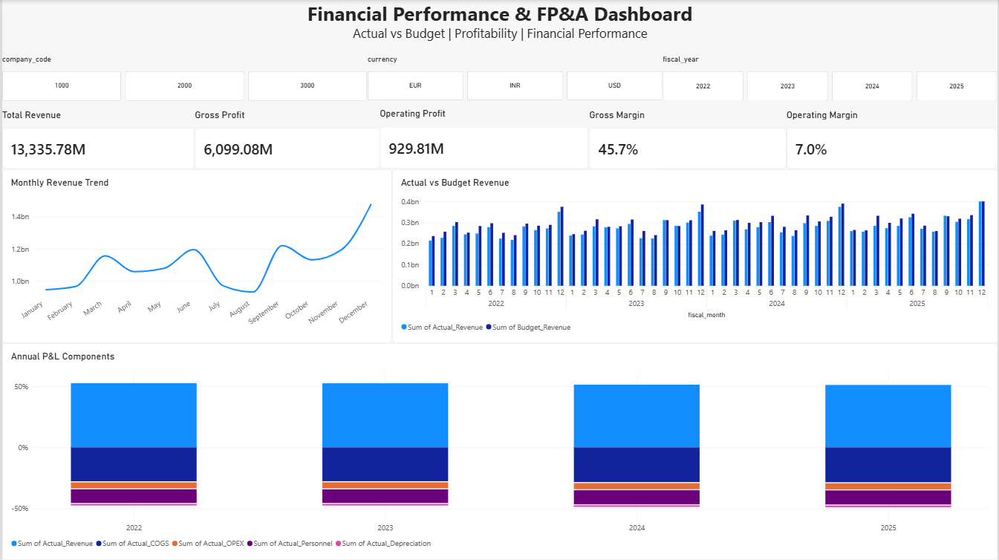

#### Key Analytical Components

- **Revenue Analysis:** Monitor actual revenue and financial performance.
- **Profitability Analysis:** Evaluate gross profit and operating profit.
- **Financial Margins:** Understand gross margin and operating margin performance.
- **Company Performance:** Compare financial results across company codes.
- **Time-Based Analysis:** Examine financial performance across fiscal periods.

#### Business Purpose

Provides management with a consolidated financial overview to understand revenue trends, profitability and overall business performance.

---

### 2. Budget & Variance Analysis

**Objective:** Evaluate differences between actual financial performance and planned budget figures.

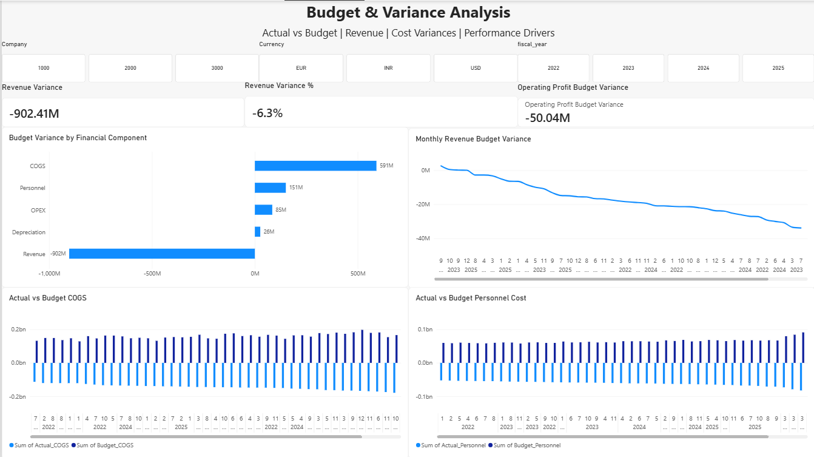

#### Key Analytical Components

- **Actual vs Budget:** Compare actual financial results against budgeted targets.
- **Revenue Variance:** Identify differences between actual and planned revenue.
- **Expense Analysis:** Examine financial expense performance.
- **Profitability Variance:** Evaluate deviations in gross and operating profitability.
- **Financial Performance Trends:** Monitor budget performance across fiscal periods.

#### Business Purpose

Helps FP&A teams understand financial deviations, identify areas requiring attention and evaluate whether business performance aligns with planned financial objectives.

---

### 3. Forecast & Machine Learning Analysis

**Objective:** Evaluate historical revenue patterns and investigate machine-learning-based revenue forecasting performance.

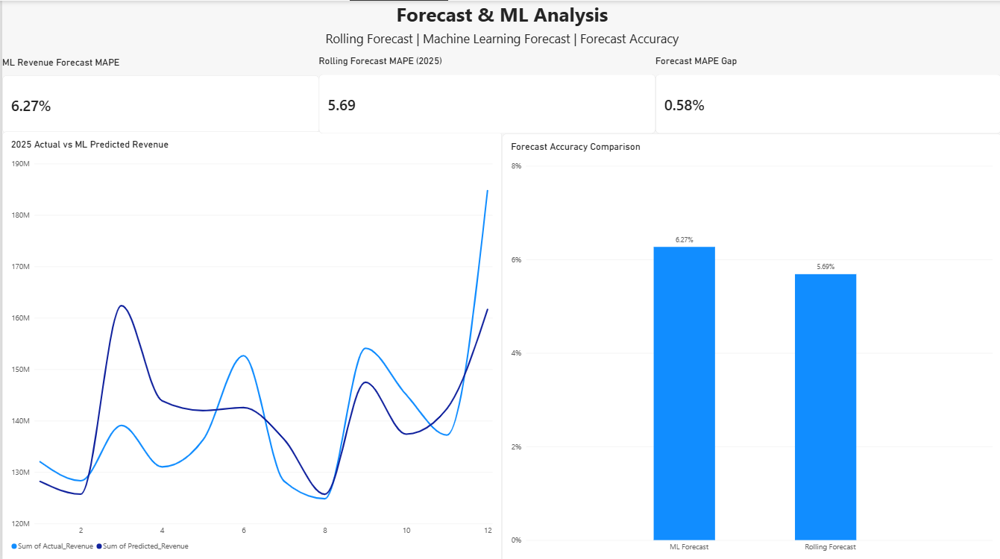

#### Key Analytical Components

- **Revenue Forecasting:** Examine Random Forest Regression predictions.
- **Historical Performance:** Compare historical revenue against forecasted values.
- **Forecast Evaluation:** Review model performance using MAE, RMSE and MAPE.
- **Benchmark Comparison:** Evaluate machine-learning forecasts against the existing rolling forecast.
- **Prediction Analysis:** Investigate differences between actual and forecasted revenue.

#### Machine Learning Approach

The forecasting workflow uses:

- Random Forest Regression.
- Historical lag-based features.
- Chronological training and testing.
- Forecast error evaluation.

#### Reported Forecasting Results

| Forecasting Method | MAPE |
|---|---:|
| Random Forest Regression | 6.27% |
| Existing Rolling Forecast | 5.69% |

**Key Observation:** The existing rolling forecast achieves a lower reported MAPE than Random Forest Regression. This comparison highlights the importance of evaluating machine-learning models against simpler forecasting benchmarks.

#### Business Purpose

Provides a comparative view of forecasting performance and helps demonstrate how predictive analytics can support financial planning and revenue estimation.

---

### 4. Financial Anomaly Detection

**Objective:** Identify potentially unusual accounting transactions that may require additional financial investigation.

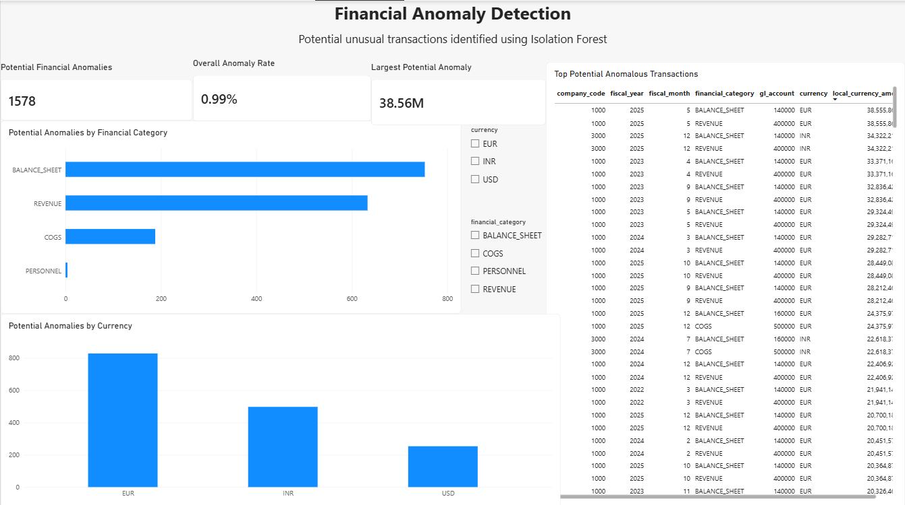

#### Key Analytical Components

- **Anomaly Identification:** Apply Isolation Forest to identify unusual transaction patterns.
- **Transaction Analysis:** Examine characteristics of flagged accounting records.
- **Financial Risk Indicators:** Highlight potentially unusual financial activity.
- **Anomaly Investigation:** Generate transaction-level records for further review.
- **Pattern Analysis:** Investigate unusual observations within the accounting dataset.

#### Machine Learning Approach

The project implements Isolation Forest with the following configuration:

| Parameter | Configuration |
|---|---|
| Algorithm | Isolation Forest |
| Number of Estimators | 200 |
| Contamination | 0.01 |
| Random State | 42 |

The model identifies approximately 1% of observations as potential anomalies according to its configured contamination parameter.

#### Business Purpose

Supports financial monitoring by highlighting unusual accounting patterns that may require investigation, validation or additional review.

> **Important:** Anomaly detection identifies statistically unusual observations. It does not independently establish fraud, accounting errors or financial misconduct.

---

### 📥 Access the Interactive Power BI Report

The complete Power BI report is available in the repository.

[**⬇️ Download Financial Performance & FP&A Power BI Dashboard (.pbix)**](powerbi/Financial_Performance_FPA_Predictive_Analytics.pbix)

The `.pbix` file can be opened using Microsoft Power BI Desktop to explore the report pages and their available interactive features.

---

### 🎯 Dashboard Summary

| Analytical Area | Business Value |
|---|---|
| Executive Financial Overview | Understand overall financial performance |
| Budget & Variance Analysis | Identify deviations from planned financial targets |
| Revenue Forecasting | Evaluate future revenue estimates |
| Model Evaluation | Compare forecasting approaches |
| Anomaly Detection | Identify potentially unusual financial transactions |
| Interactive Reporting | Explore financial information through Power BI |

**The four dashboards collectively demonstrate the application of financial analytics, predictive modelling and business intelligence to support FP&A activities.**

---

---

## ✨ Key Features & Analytical Capabilities

The project is organized into four major analytical modules, combining financial data processing, business intelligence, predictive modelling and anomaly detection.

Each module addresses a specific financial analytics problem and demonstrates the practical application of Python, SQL, Machine Learning and Power BI.

### 📌 Analytical Modules Overview

| Module | Key Technologies | Analytical Focus |
|---|---|---|
| Financial Performance Analysis | Python, Pandas, NumPy, SQL, DAX | Financial reporting and profitability |
| Budget & Variance Analysis | Python, SQL, Power BI, DAX | Actual vs Budget performance |
| Predictive Revenue Analytics | Scikit-learn, Random Forest, Pandas | Revenue forecasting and model evaluation |
| Financial Anomaly Detection | Isolation Forest, Python, Statistical Analysis | Potentially unusual transaction identification |

---

### 💰 1. Financial Performance Analysis

**Objective:** Transform raw SAP-style accounting transactions into structured financial information for performance measurement and profitability analysis.

This module focuses on processing accounting records, validating financial data and constructing important Profit & Loss (P&L) indicators.

#### Key Features

- **Financial Data Processing:** Clean, transform and organize accounting transaction records.
- **Data Quality Validation:** Identify missing values, duplicate records and inconsistencies.
- **Accounting Sign Normalization:** Convert debit and credit entries into signed financial amounts.
- **G/L Account Classification:** Map general ledger accounts into financial categories.
- **P&L Construction:** Calculate Revenue, COGS, Gross Profit and Operating Profit.
- **Profitability Analysis:** Calculate Gross Margin and Operating Margin.
- **Organizational Analysis:** Analyze financial performance across company codes, cost centers and profit centers.
- **Document Reconciliation:** Validate debit and credit balances at accounting document level.

#### Financial Metrics

| Metric | Description |
|---|---|
| Revenue | Income generated from business activities |
| Cost of Goods Sold (COGS) | Direct costs associated with goods sold |
| Gross Profit | Revenue after deducting COGS |
| Operating Profit | Profit after deducting operating expenses |
| Gross Margin | Gross Profit as a percentage of Revenue |
| Operating Margin | Operating Profit as a percentage of Revenue |

#### Technical Implementation

| Technology | Application |
|---|---|
| Python | Financial data processing and calculations |
| Pandas | Data cleaning, grouping and transformation |
| NumPy | Numerical calculations |
| MySQL | Financial data querying and aggregation |
| SQL Joins | Connecting accounting records with master data |
| DAX | Financial KPI calculations and dashboard measures |

#### Key Analytical Result

| Validation Metric | Result |
|---|---:|
| Accounting Transaction Lines | 159,934 |
| Accounting Documents | 79,967 |
| Document-Level Reconciliation Rate | 100% |

The reconciliation result represents documents whose debit and credit totals balance within the implemented tolerance of 0.01.

**Business Value:** Provides a structured financial overview that helps analysts understand revenue composition, expense distribution, profitability and accounting data quality.

---

### 📊 2. Budget & Variance Analysis

**Objective:** Evaluate actual financial performance against planned budgets and rolling forecasts to identify deviations from financial targets.

This module focuses on financial planning, budget monitoring and performance variance analysis.

#### Key Features

- **Actual vs Budget Analysis:** Compare actual revenue and expenses against budgeted amounts.
- **Revenue Variance:** Calculate differences between actual and planned revenue.
- **Profitability Variance:** Compare actual and budgeted gross profit and operating profit.
- **Expense Analysis:** Investigate COGS, personnel expenses, OPEX and depreciation.
- **Rolling Forecast Comparison:** Evaluate rolling forecast values against budgeted financial performance.
- **Monthly Financial Trends:** Examine financial movements across fiscal periods.
- **Year-over-Year Analysis:** Compare financial performance across fiscal years.
- **Cost Center Analysis:** Examine financial performance across organizational cost centers.

#### Financial Performance Indicators

| KPI | Calculation |
|---|---|
| Revenue Variance | Actual Revenue − Budget Revenue |
| Revenue Variance % | Revenue Variance / Budget Revenue × 100 |
| Gross Profit Variance | Actual Gross Profit − Budget Gross Profit |
| Operating Profit Variance | Actual Operating Profit − Budget Operating Profit |
| Forecast Variance | Rolling Forecast − Budget |
| Year-over-Year Growth | Current-Year Revenue compared with Previous-Year Revenue |

#### SQL Analytical Capabilities

The MySQL implementation includes:

- Common Table Expressions (CTEs).
- Aggregate functions.
- Conditional aggregation using CASE.
- Multi-table JOIN operations.
- Window Functions.
- LAG() for year-over-year comparison.
- AVG() OVER() for rolling revenue analysis.
- Reusable financial analysis views.
- Document-level reconciliation queries.

#### Key Technologies

| Technology | Application |
|---|---|
| Python | Financial calculations and data preparation |
| MySQL | Budget and financial performance queries |
| SQL | Variance analysis and financial aggregation |
| Power BI | Interactive financial reporting |
| DAX | Dynamic financial KPI calculations |

**Business Value:** Helps financial analysts investigate budget deviations, understand profitability movements and monitor financial performance against planned objectives.

---

### 🤖– 3. Predictive Revenue Analytics

**Objective:** Investigate historical revenue patterns and evaluate the performance of machine-learning-based revenue forecasting.

This module applies Random Forest Regression to historical revenue data and compares the resulting predictions against an existing rolling forecast benchmark.

#### Key Features

- **Historical Revenue Analysis:** Examine monthly revenue patterns.
- **Time-Based Feature Engineering:** Generate historical lag features.
- **Random Forest Regression:** Train a supervised regression model for revenue estimation.
- **Chronological Train-Test Split:** Use historical observations for training and 2025 observations for testing.
- **Forecast Visualization:** Compare actual revenue against predicted revenue.
- **Model Evaluation:** Measure prediction errors using standard regression metrics.
- **Benchmark Comparison:** Compare machine-learning predictions with the existing rolling forecast.

#### Machine Learning Methodology

**Algorithm:** Random Forest Regressor

**Input Features:**

| Feature | Description |
|---|---|
| Lag 1 | Revenue from the previous month |
| Lag 2 | Revenue from two months earlier |
| Lag 3 | Revenue from three months earlier |
| Lag 12 | Revenue from the same month of the previous year |

**Model Configuration:**

| Parameter | Value |
|---|---:|
| Algorithm | Random Forest Regressor |
| Number of Estimators | 300 |
| Maximum Depth | 5 |
| Random State | 42 |
| Test Period | January–December 2025 |

The forecasting experiment focuses on Company Code 1000.

#### Model Evaluation Metrics

| Evaluation Metric | Purpose |
|---|---|
| MAE | Measures average absolute prediction error |
| RMSE | Penalizes larger prediction errors |
| MAPE | Measures average absolute percentage error |

#### Reported Forecasting Results

| Forecasting Method | MAPE |
|---|---:|
| Random Forest Regression | 6.27% |
| Existing Rolling Forecast | 5.69% |

**Key Finding:**

The existing rolling forecast achieved a lower reported MAPE than the Random Forest model during the evaluated 2025 period.

The result demonstrates why machine-learning models should be evaluated against existing forecasting approaches rather than assuming that greater model complexity guarantees better performance.

The lag-12 feature was reported as the most important feature in the Random Forest model.

**Business Value:** Demonstrates how historical financial information can be used to investigate revenue patterns, evaluate forecasting approaches and support financial planning.

---

### 🔎 4. Financial Anomaly Detection

**Objective:** Identify potentially unusual accounting transactions using unsupervised machine learning.

This module applies Isolation Forest to identify transactions with unusual financial characteristics and generate investigation records for further analysis.

#### Key Features

- **Transaction Distribution Analysis:** Examine accounting transaction amounts and their distributions.
- **Statistical Exploration:** Investigate transaction percentiles and amount distributions.
- **Isolation Forest:** Apply an unsupervised anomaly detection algorithm.
- **Contextual Feature Engineering:** Extend anomaly analysis using financial category and debit/credit information.
- **Anomaly Classification:** Separate observations into normal and potentially unusual transactions.
- **Transaction Investigation:** Generate a dataset containing flagged transactions.
- **Category-Level Analysis:** Summarize potentially unusual transactions by financial category and currency.
- **Anomaly Monitoring:** Calculate transaction counts and anomaly percentages.

#### Machine Learning Methodology

**Algorithm:** Isolation Forest

The implementation includes two configurations:

**Model 1 — Amount-Based Detection**

Uses transaction amount as the input feature.

**Model 2 — Context-Aware Detection**

Extends the input features using:

- Transaction Amount
- Financial Category Code
- Debit/Credit Code

#### Model Configuration

| Parameter | Value |
|---|---:|
| Algorithm | Isolation Forest |
| Number of Estimators | 200 |
| Contamination | 0.01 |
| Random State | 42 |

#### Reported Anomaly Detection Results

| Metric | Result |
|---|---:|
| Potential Financial Anomalies | 1,578 |
| Overall Potential Anomaly Rate | 0.99% |
| Configured Contamination | 1% |

#### Analytical Outputs

The implementation produces:

- Potentially unusual transaction records.
- Financial category-level anomaly summaries.
- Currency-level flagged transaction summaries.
- Transaction amount statistics.
- Comparison between amount-based and context-aware anomaly classifications.
- Records requiring additional financial investigation.

**Business Value:** Supports financial transaction monitoring by highlighting unusual patterns that finance teams may investigate further.

> **Important:** Isolation Forest identifies statistically unusual observations. The configured contamination parameter influences the proportion of observations flagged. The model does not establish fraud, accounting errors or financial misconduct.

---

### 🛠️ Technical Skills Demonstrated

The four analytical modules collectively demonstrate the following technical capabilities:

| Skill Category | Technologies / Techniques |
|---|---|
| Programming | Python |
| Data Manipulation | Pandas, NumPy |
| Database Management | MySQL |
| SQL Analytics | Joins, CTEs, Window Functions, Aggregations |
| Data Analysis | Exploratory Data Analysis, Data Validation |
| Financial Analytics | P&L, Budgeting, Variance Analysis, Profitability |
| Statistical Analysis | Descriptive Statistics, Percentiles, Error Metrics |
| Machine Learning | Scikit-learn |
| Predictive Modelling | Random Forest Regression |
| Anomaly Detection | Isolation Forest |
| Model Evaluation | MAE, RMSE, MAPE |
| Business Intelligence | Power BI |
| Data Visualization | Power BI Charts and Reports |
| Dashboard Calculations | DAX |
| Development Environment | Jupyter Notebook |

---

### 📈 Overall Analytical Outcomes

The project produces the following documented analytical outputs:

| Analytical Area | Outcome |
|---|---|
| Financial Data Processing | 159,934 accounting transaction lines processed |
| Accounting Validation | 79,967 documents reconciled |
| Financial Reporting | Revenue, COGS, Gross Profit and Operating Profit |
| Budget Analysis | Actual vs Budget financial comparisons |
| Forecasting | Random Forest revenue predictions for 2025 |
| Forecast Evaluation | ML and rolling forecast MAPE comparison |
| Anomaly Detection | 1,578 potentially unusual transactions identified |
| Business Intelligence | Four-page interactive Power BI report |

---

### 💼 Practical Business Applications

The analytical capabilities developed in this project are relevant to several financial and business functions:

- Financial Planning & Analysis (FP&A).
- Financial Reporting and Performance Monitoring.
- Budget and Expense Management.
- Revenue Forecasting.
- Financial Transaction Monitoring.
- Management Reporting.
- Business Intelligence and Decision Support.

The project demonstrates how Python, SQL, Machine Learning and Power BI can work together to transform accounting information into structured financial analysis and business intelligence.

---

---

## 🛠️ Technology Stack & Tools

The project combines programming, data manipulation, database querying, machine learning and business intelligence technologies to develop an integrated financial analytics solution.

The technology stack is organized around the complete analytical workflow, from financial data processing and SQL analysis to predictive modelling and interactive dashboard development.

### 💻 1. Programming & Data Analysis

<div>


</div>

| Technology | Purpose | Application |
|---|---|---|
| Python | Programming and analytical processing | Financial data analysis and model development |
| Pandas | Data manipulation | Data cleaning, transformation, grouping and aggregation |
| NumPy | Numerical computation | Financial calculations and numerical operations |
| Matplotlib | Data visualization | Historical revenue visualization and analytical plotting |

### 🗄️ 2. Database & SQL Analytics

<div>


</div>

| Technology | Purpose | Application |
|---|---|---|
| MySQL | Relational database querying | Financial data analysis and reporting |
| SQL | Data retrieval and analytical queries | Joins, CTEs, aggregations and Window Functions |

**SQL Capabilities Demonstrated:**

- Multi-table JOIN operations.
- Common Table Expressions (CTEs).
- Aggregate Functions.
- Conditional Aggregation using CASE.
- Window Functions.
- LAG() for historical comparisons.
- AVG() OVER() for rolling analysis.
- Financial views and reusable analytical queries.
- Accounting document reconciliation.

### 🤖– 3. Machine Learning & Predictive Analytics

<div>


</div>

| Technology / Algorithm | Purpose | Application |
|---|---|---|
| Scikit-learn | Machine learning framework | Model development and evaluation |
| Random Forest Regressor | Supervised learning | Historical revenue forecasting |
| Isolation Forest | Unsupervised learning | Potentially unusual transaction identification |
| MAE | Regression evaluation | Measures average absolute prediction error |
| RMSE | Regression evaluation | Measures prediction error with greater penalty for larger errors |
| MAPE | Forecast evaluation | Measures average absolute percentage error |

**Machine Learning Techniques Demonstrated:**

- Feature Engineering using historical lag variables.
- Chronological Train-Test Splitting.
- Random Forest Regression.
- Unsupervised Anomaly Detection.
- Model Evaluation and Benchmark Comparison.
- Feature Importance Analysis.

### 📊 4. Business Intelligence & Visualization

<div>


</div>

| Technology | Purpose | Application |
|---|---|---|
| Microsoft Power BI | Business Intelligence | Interactive financial dashboards |
| DAX | Analytical calculations | Financial KPIs and performance measures |
| Power BI Data Model | Data organization | Financial reporting and dashboard analysis |
| Power BI Desktop | Report development | Interactive report creation and visualization |

**Dashboard Capabilities:**

- Financial KPI Monitoring.
- Revenue and Profitability Analysis.
- Budget vs Actual Comparison.
- Forecast Performance Visualization.
- Financial Anomaly Monitoring.
- Fiscal Period and Company-Level Analysis.

### 📓 5. Development Environment & Tools

<div>


</div>

| Tool | Purpose |
|---|---|
| Jupyter Notebook | Interactive Python development and exploratory data analysis |
| Kaggle | Original notebook execution environment and dataset access workflow |
| Git | Version control |
| GitHub | Source code hosting and project documentation |
| Power BI Desktop | Dashboard development and report exploration |
| MySQL | SQL query execution environment |

### 📊 6. Complete Technology Summary

| Category | Technology | Skill Demonstrated |
|---|---|---|
| Programming | Python | Analytical programming |
| Data Manipulation | Pandas, NumPy | Data cleaning and transformation |
| Visualization | Matplotlib | Analytical plotting |
| Database | MySQL | Financial data querying |
| Query Language | SQL | Advanced analytical queries |
| Machine Learning | Scikit-learn | Predictive modelling |
| Regression | Random Forest | Revenue forecasting |
| Anomaly Detection | Isolation Forest | Unusual transaction identification |
| Business Intelligence | Power BI | Interactive reporting |
| Calculations | DAX | Financial KPI development |
| Development | Jupyter Notebook | Exploratory data analysis |
| Version Control | Git, GitHub | Source control and documentation |

### 🎯 Technology-to-Workflow Mapping

The following table illustrates how different technologies contribute to the overall financial analytics workflow.

| Analytical Stage | Technologies Used |
|---|---|
| Data Acquisition | Kaggle Dataset, CSV |
| Data Processing | Python, Pandas, NumPy |
| Data Validation | Python, Pandas |
| Financial Analysis | Python, SQL, MySQL |
| Financial Reporting | SQL, DAX, Power BI |
| Revenue Forecasting | Python, Pandas, Scikit-learn |
| Anomaly Detection | Python, Scikit-learn |
| Model Evaluation | NumPy, Scikit-learn |
| Dashboard Development | Power BI, DAX |
| Project Management | Git, GitHub |

---

---

## 🏗️ System Architecture & Data Flow

The Financial Performance & FP&A Predictive Analytics project follows a structured analytical architecture that integrates financial data processing, SQL-based analysis, predictive modelling and interactive business intelligence.

The architecture is organized into three major analytical workstreams:

1. **Python Data Analytics Pipeline:** Handles financial data preparation, validation, P&L construction, budget analysis, forecasting and anomaly detection.
2. **SQL Analytics Layer:** Provides relational database querying, financial aggregations, reconciliation and advanced analytical reporting.
3. **Power BI Reporting Layer:** Presents financial performance, budget variances, forecasting results and anomaly investigation through interactive dashboards.

The components collectively demonstrate how raw financial information can be transformed into structured analytical outputs and business intelligence.

### 1. High-Level System Architecture

The following diagram illustrates the overall architecture and the relationship between the analytical components.

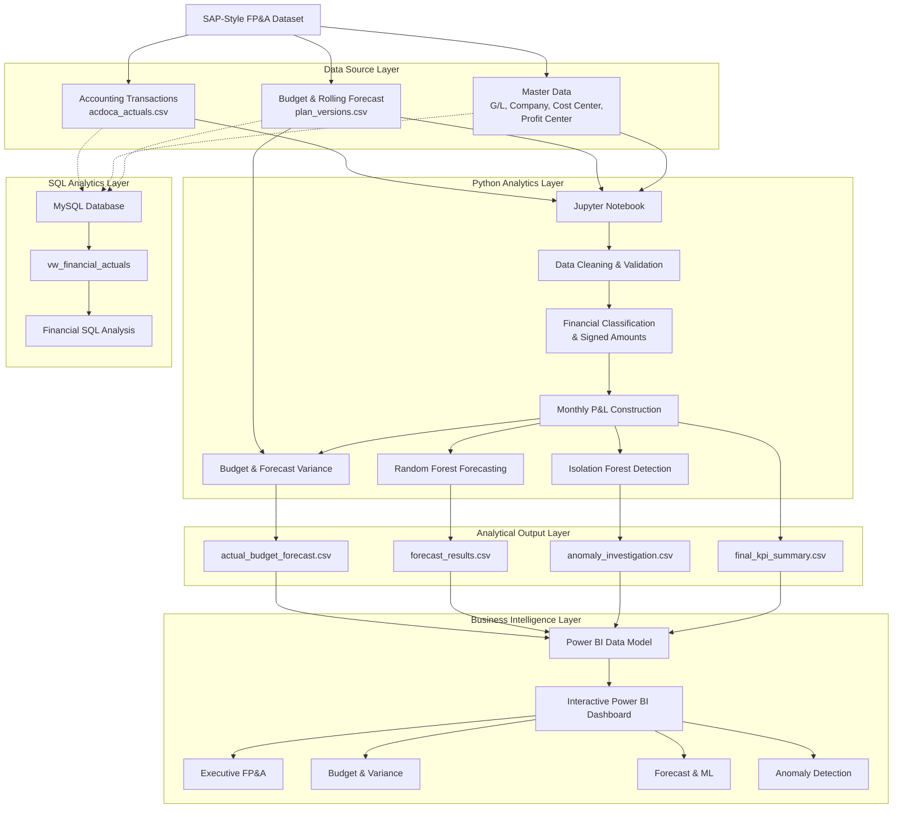

> **Architecture note:** The SQL branch represents a separate analytical workflow. The source tables must be loaded into MySQL independently. The supplied SQL script does not implement the complete data-loading process. The dashed connections indicate this separate source-data preparation requirement.

---

### 2. Data Ingestion & Source Layer

**Objective:** Obtain the accounting transactions, financial planning information and organizational master data required for financial analysis.

The project uses an SAP-style FP&A dataset based on the ACDOCA Universal Journal structure.

The source dataset contains the following major data components:

| Data Source | Description | Purpose |
|---|---|---|
| `acdoca_actuals.csv` | Actual accounting transactions | Historical financial performance |
| `plan_versions.csv` | Budget and rolling forecast records | Financial planning and variance analysis |
| `dim_gl_account.csv` | G/L account master data | Financial classification |
| `dim_company_code.csv` | Company master data | Organizational reporting |
| `dim_cost_center.csv` | Cost center master data | Cost analysis |
| `dim_cost_center_group.csv` | Cost center grouping | Organizational classification |
| `dim_profit_center.csv` | Profit center master data | Profitability analysis |

#### Data Source Characteristics

| Attribute | Description |
|---|---|
| Accounting Transaction Lines | 159,934 |
| Accounting Documents | 79,967 |
| Company Codes | 1000, 2000, 3000 |
| Fiscal Period | 2022–2025 |
| Currencies | EUR, USD, INR |
| Accounting Structure | SAP-style ACDOCA |

**Source:** SAP FP&A dataset by Ajay Kumar, available through the referenced dataset publication.

The complete raw transaction files are not included in this GitHub repository and must be obtained from the original dataset source.

---

### 3. Python Data Processing Architecture

**Objective:** Convert raw accounting transactions into structured financial information suitable for analytical processing.

The Python notebook implements the primary data preparation and financial analysis workflow.

#### Data Processing Workflow

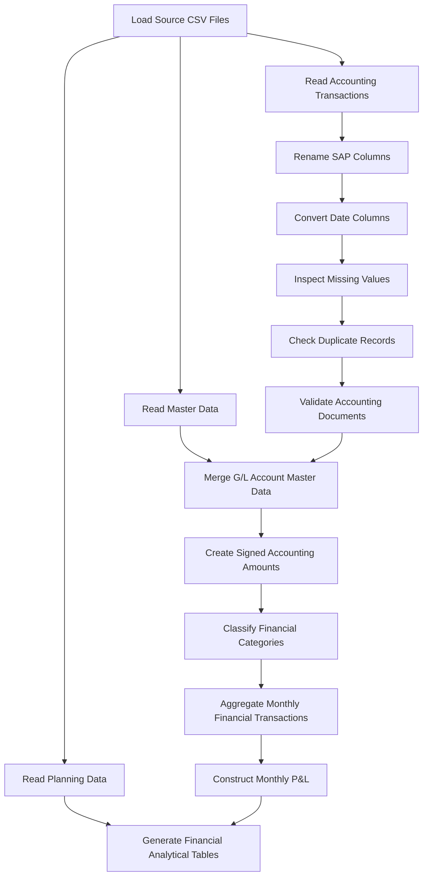

#### Major Processing Activities

**Stage 1 — Data Loading**

Load accounting transactions, planning records and master data using Pandas.

**Stage 2 — Data Cleaning**

- Standardize column names.
- Convert posting and document dates.
- Inspect missing values.
- Identify duplicate records.
- Examine transaction distributions.

**Stage 3 — Financial Validation**

- Validate accounting document balances.
- Examine debit and credit distributions.
- Check document and line-item combinations.
- Review missing organizational information.

**Stage 4 — Financial Classification**

Merge accounting transactions with G/L account master data to identify financial categories.

**Stage 5 — Accounting Sign Normalization**

Create signed accounting amounts using debit and credit indicators:

| Debit/Credit Indicator | Analytical Treatment |
|---|---|
| S — Debit | Positive amount |
| H — Credit | Negative amount |

**Stage 6 — P&L Construction**

Aggregate accounting transactions into monthly financial categories and construct financial performance indicators.

The resulting analysis includes:

- Revenue.
- Cost of Goods Sold.
- Personnel Expenses.
- Operating Expenses.
- Depreciation.
- Gross Profit.
- Operating Profit.
- Gross Margin.
- Operating Margin.

---

### 4. Budget & Financial Variance Processing

**Objective:** Combine actual financial performance with budget and rolling forecast information.

The notebook processes planning records using financial categories, company codes, fiscal periods and currencies.

#### Budget Analysis Workflow

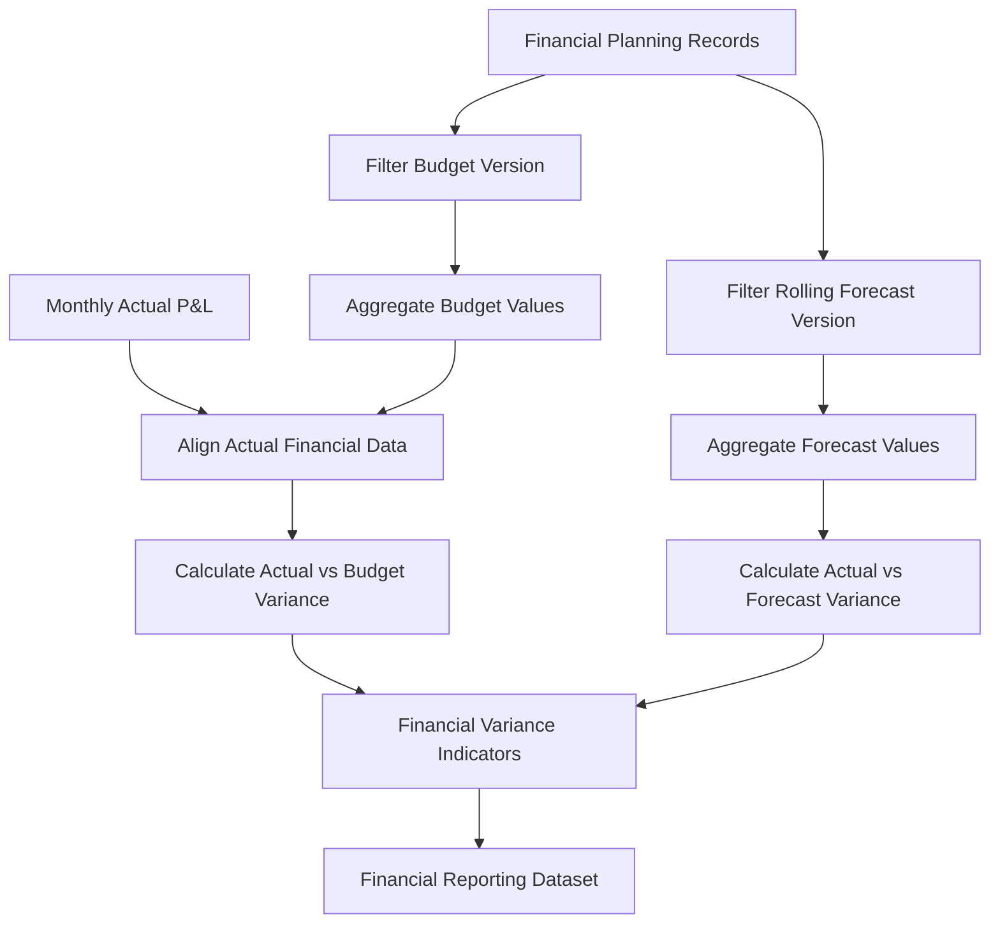

#### Key Processing Operations

- Filter Budget and Rolling Forecast planning versions.
- Aggregate planned financial values monthly.
- Pivot financial categories into P&L components.
- Merge actual and budget financial information.
- Calculate revenue variances.
- Calculate expense variances.
- Calculate gross profit variances.
- Calculate operating profit variances.
- Evaluate forecast deviations.

The analysis preserves currency and company-code dimensions when aligning financial values.

---

### 5. Predictive Analytics Architecture

**Objective:** Evaluate historical revenue patterns using Random Forest Regression and compare its forecasting performance against the existing rolling forecast.

#### Revenue Forecasting Workflow

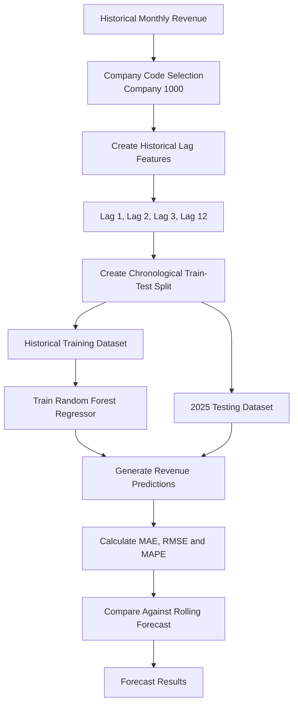

#### Forecasting Model Configuration

| Parameter | Configuration |
|---|---|
| Algorithm | Random Forest Regressor |
| Number of Estimators | 300 |
| Maximum Depth | 5 |
| Random State | 42 |
| Forecasting Company | 1000 |
| Testing Period | January–December 2025 |

#### Model Evaluation

The model uses:

- Mean Absolute Error (MAE).
- Root Mean Squared Error (RMSE).
- Mean Absolute Percentage Error (MAPE).

The forecasting results are compared with the existing rolling forecast benchmark.

The notebook follows a chronological rolling one-step-ahead evaluation approach for the 2025 test period, using historical lag features.

---

### 6. Financial Anomaly Detection Architecture

**Objective:** Identify potentially unusual accounting transactions through unsupervised machine learning.

The project implements two Isolation Forest configurations.

#### Anomaly Detection Workflow

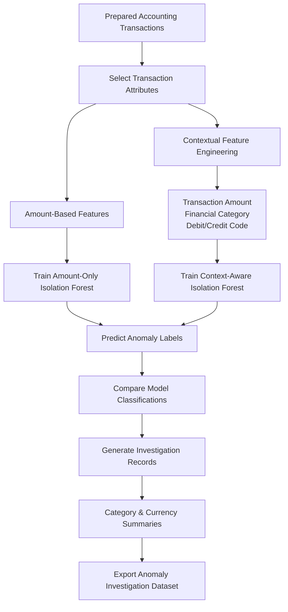

#### Anomaly Detection Configuration

| Parameter | Configuration |
|---|---|
| Algorithm | Isolation Forest |
| Number of Estimators | 200 |
| Contamination | 0.01 |
| Random State | 42 |

The context-aware implementation uses:

- Transaction Amount.
- Encoded Financial Category.
- Encoded Debit/Credit Indicator.

The resulting anomaly labels are used to generate transaction-level investigation records.

> **Important:** The model identifies statistically unusual observations. Its contamination setting influences the number of observations flagged. Anomaly predictions are not confirmed financial errors or fraud indicators.

---

### 7. SQL Database & Analytics Architecture

**Objective:** Provide a relational SQL-based approach for investigating financial transactions and generating reusable analytical queries.

The project includes a MySQL analytical script that creates a dedicated database and a reusable financial analysis view.

#### SQL Architecture

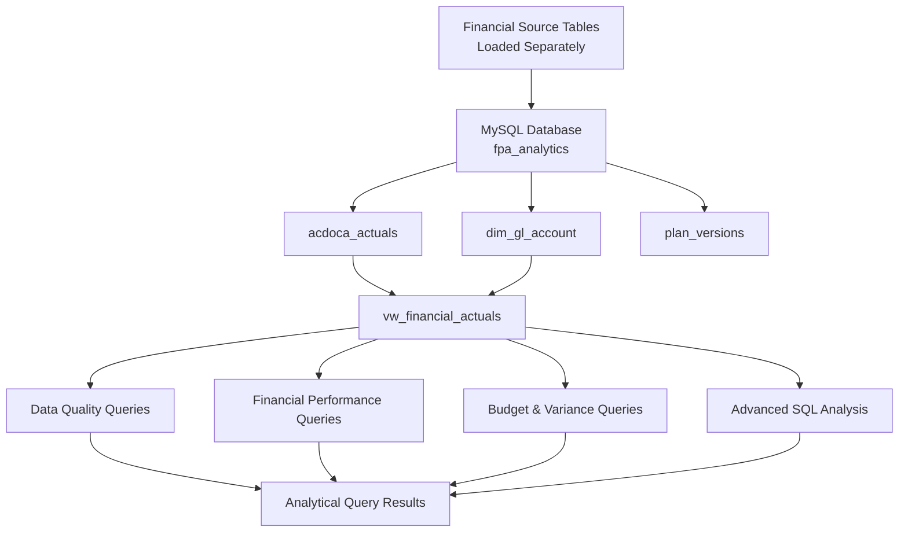

#### SQL Analytical Components

| SQL Component | Purpose |
|---|---|
| Database Creation | Create `fpa_analytics` |
| Data Profiling | Inspect accounting tables and records |
| Missing-Value Analysis | Identify incomplete accounting information |
| Duplicate Detection | Examine duplicate transaction records |
| Financial View | Create `vw_financial_actuals` |
| P&L Analysis | Calculate financial performance |
| Cost Center Analysis | Evaluate expense distribution |
| Profit Center Analysis | Compare revenue contribution |
| Document Reconciliation | Validate debit and credit balances |
| Budget Variance | Compare actual and planned performance |
| Year-over-Year Analysis | Apply LAG() to historical revenue |
| Rolling Revenue | Apply window-based moving averages |

**Implementation note:** The supplied SQL script references source tables such as `acdoca_actuals`, `dim_gl_account`, `plan_versions` and `actual_budget_monthly`. Their complete creation and loading process is not included in the repository. The SQL workflow therefore requires separate database preparation.

---

### 8. Power BI Reporting Architecture

**Objective:** Transform the prepared analytical results into interactive financial dashboards.

The project includes an actual Power BI report (`.pbix`) with four report pages.

The report's internal model layout identifies the following tables:

| Power BI Model Table | Analytical Purpose |
|---|---|
| FP&A | Financial performance reporting |
| Variance Category | Financial variance classification |
| forecast_results | Revenue forecasting results |
| Forecast Method | Forecasting method comparison |
| anomaly_investigation | Potential anomaly investigation |

#### Dashboard Data Flow

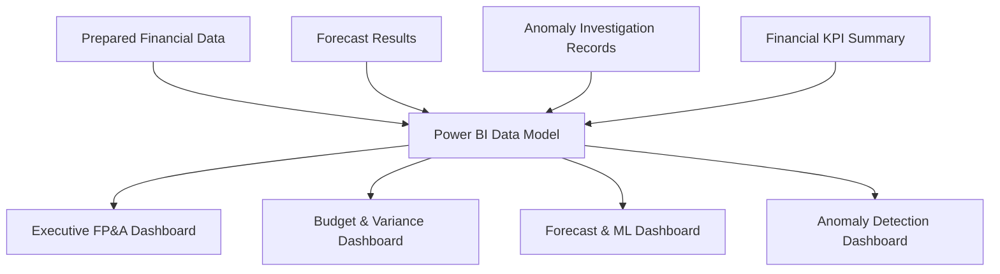

#### Dashboard Reporting Pages

| Page | Analytical Responsibility |
|---|---|
| Executive FP&A Dashboard | Financial performance and profitability |
| Budget & Variance Analysis | Actual versus budget performance |
| Forecast & ML Analysis | Revenue forecast and model comparison |
| Anomaly Detection | Potentially unusual transaction analysis |

The `.pbix` report contains the Power BI data model and report definitions. Its exact external data-source bindings and refresh configuration should be verified in Power BI Desktop before documenting an automated refresh workflow.

---

### 9. Analytical Output & Export Layer

**Objective:** Persist the results generated by the Python notebook for reporting and further analysis.

The notebook exports four principal analytical CSV files to the Kaggle working directory.

| Output File | Description |
|---|---|
| `actual_budget_forecast.csv` | Actual, budget and rolling forecast financial analysis |
| `forecast_results.csv` | Actual versus Random Forest predicted revenue |
| `anomaly_investigation.csv` | Transactions identified by context-aware anomaly detection |
| `final_kpi_summary.csv` | Consolidated financial and analytical KPI results |

These output files are also included in the project's `data/` directory.

The files provide the prepared analytical results associated with the Power BI reporting workflow.

---

### 10. End-to-End Analytical Workflow

The following diagram summarizes the major stages of the complete project.

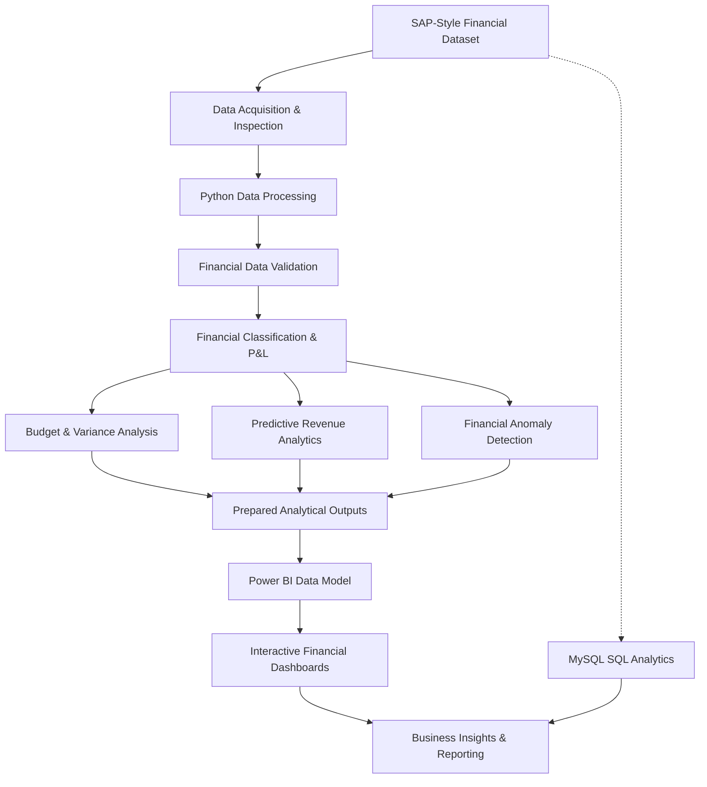

---

### 11. Architecture Design Principles

The project demonstrates the following analytical and engineering principles:

| Principle | Implementation |
|---|---|
| Data Separation | Source data, analytical outputs and reporting assets are organized separately |
| Data Quality | Missing-value, duplicate and reconciliation checks |
| Financial Consistency | Signed accounting amounts and financial category classification |
| Reusable Analytics | SQL financial analysis view |
| Predictive Evaluation | Chronological model evaluation and benchmark comparison |
| Unsupervised Learning | Isolation Forest anomaly identification |
| Business Intelligence | Dedicated Power BI reporting pages |
| Analytical Documentation | Notebooks, SQL scripts, DAX measures and project documentation |

### 12. Architecture Limitations & Implementation Notes

The following limitations should be considered when reproducing the project:

- The complete raw accounting transaction and planning datasets are not included in the GitHub repository.
- The Python notebook currently references its original Kaggle input location.
- The MySQL SQL script assumes that required source tables have already been loaded.
- The SQL script does not provide a complete end-to-end database initialization and data-loading pipeline.
- The Power BI report contains a packaged data model, but its refresh and external source configuration should be independently verified.
- Financial amounts in EUR, USD and INR must be analyzed separately unless an appropriate exchange-rate conversion methodology is implemented.
- The anomaly detection workflow does not use verified ground-truth anomaly labels.

These boundaries distinguish the implemented analytical workflow from additional engineering work that could improve future reproducibility and automation.

---

### ✅ Architecture Summary

The project demonstrates an integrated approach to financial data analytics through three complementary technical workstreams.

**Python** performs data processing, financial calculations, predictive modelling and anomaly detection.

**MySQL** supports structured financial querying, reconciliation and advanced SQL analysis.

**Power BI** transforms prepared financial results into interactive reports that communicate business performance, forecasting comparisons and potential financial anomalies.

Together, these components demonstrate the practical application of data analytics and machine learning techniques to Financial Planning & Analysis workflows.

---

---

## 📁 Project Structure

The repository follows a modular directory structure to organize financial datasets, analytical notebooks, SQL scripts, Power BI reports and project documentation.

Each directory serves a specific purpose within the financial analytics workflow, making the project easier to navigate, understand and reproduce.

### 🗂️ Complete Repository Structure

```text
financial-fpa-predictive-analytics/
│
├── data/                                              # Processed datasets and analytical outputs
│   ├── actual_budget_forecast.csv                     # Actual, budget and rolling forecast results
│   ├── anomaly_investigation.csv                      # Transactions flagged for anomaly investigation
│   ├── final_kpi_summary.csv                          # Consolidated financial and analytical KPIs
│   ├── forecast_results.csv                            # Actual and predicted revenue results
│   └── master_data/                                   # Financial and organizational reference data
│       ├── dim_company_code.csv                       # Company code reference information
│       ├── dim_cost_center.csv                        # Cost center reference information
│       ├── dim_cost_center_group.csv                  # Cost center group classifications
│       ├── dim_gl_account.csv                         # General ledger account reference information
│       └── dim_profit_center.csv                      # Profit center reference information
│
├── docs/                                              # Project documentation and dashboard previews
│   ├── dashboard_preview/                             # Screenshots of the four Power BI report pages
│   │   ├── 01_executive_overview.png                  # Executive financial performance dashboard
│   │   ├── 02_budget_variance.png                     # Budget and financial variance dashboard
│   │   ├── 03_forecast_ml.png                          # Revenue forecasting and machine learning dashboard
│   │   └── 04_anomaly_detection.png                   # Financial anomaly detection dashboard
│   └── Project_Documentation.docx                     # Detailed financial project documentation
│
├── notebooks/                                         # Python analytics and predictive modelling
│   └── fpa_predictive_analytics.ipynb                 # End-to-end financial analytics notebook
│
├── powerbi/                                           # Power BI report and dashboard calculations
│   ├── Financial_Performance_FPA_Predictive_Analytics.pbix  # Interactive four-page Power BI report
│   └── dax_measures.dax                               # DAX measures for financial KPI calculations
│
├── sql/                                               # SQL scripts for financial data analysis
│   └── mysql_fpa_analysis.sql                         # MySQL financial analysis queries
│
├── .gitignore                                         # Files and directories excluded from Git
├── README.md                                          # Main project overview and documentation
└── folder_stucture.txt                                # Text-based representation of the repository structure
```

### 📂 Directory Responsibilities

| Directory / File | Responsibility |
|---|---|
| `data/` | Stores processed financial datasets and analytical outputs |
| `data/master_data/` | Contains company, G/L account, cost center and profit center reference data |
| `docs/` | Maintains project documentation and technical references |
| `docs/dashboard_preview/` | Contains screenshots of the four Power BI dashboard pages |
| `notebooks/` | Contains Python-based financial analysis and machine learning implementation |
| `powerbi/` | Stores the interactive Power BI report and DAX measures |
| `sql/` | Contains MySQL scripts for financial data analysis |
| `.gitignore` | Defines files and directories excluded from Git tracking |
| `README.md` | Provides the main project overview and documentation |
| `folder_stucture.txt` | Provides a readable representation of the project directory structure |

### 📄 Important Project Files

| File | Description |
|---|---|
| `fpa_predictive_analytics.ipynb` | Implements data processing, financial analysis, forecasting and anomaly detection |
| `mysql_fpa_analysis.sql` | Contains MySQL queries for financial reporting, reconciliation and analytical operations |
| `dax_measures.dax` | Contains DAX calculations for financial performance indicators |
| `Financial_Performance_FPA_Predictive_Analytics.pbix` | Contains the interactive four-page Power BI report |
| `actual_budget_forecast.csv` | Stores processed actual, budget and forecast financial information |
| `forecast_results.csv` | Contains actual and predicted revenue values |
| `anomaly_investigation.csv` | Contains potentially unusual transactions identified during anomaly detection |
| `final_kpi_summary.csv` | Stores consolidated financial and analytical metrics |
| `Project_Documentation.docx` | Provides additional project methodology and documentation |

### 📝 Repository Organization Principles

The project structure follows these organizational principles:

- **Separation of Concerns:** Data, source code, SQL queries, reports and documentation are maintained in dedicated directories.
- **Reproducibility:** Analytical notebooks and SQL scripts are kept separate from generated outputs.
- **Documentation:** Project structure, methodology and dataset attribution are documented independently.
- **Visualization:** Dashboard screenshots are organized separately from the original Power BI report.
- **Maintainability:** The modular structure makes individual analytical components easier to locate and update.

> **Data Availability Note:** The repository contains processed analytical outputs and master-data reference files. The complete original accounting transaction and planning datasets are not included and must be obtained from their original source before reproducing the entire analytical pipeline.

---

---

## 🚀 Getting Started & Reproducibility

This section provides instructions for setting up the Financial Performance & FP&A Predictive Analytics project in a local development environment.

It covers the Python environment, dataset configuration, MySQL database preparation, SQL execution, Jupyter Notebook execution and Power BI dashboard access.

Following these instructions allows developers to explore the analytical workflow and reproduce the project's financial analysis.

### 📋 1. Prerequisites

Before getting started, ensure that the following tools are installed.

| Requirement | Recommended Version | Purpose |
|---|---|---|
| Python | 3.12 | Data processing and machine learning |
| pip | Latest | Python dependency management |
| MySQL Server | 8.0+ | Relational database and SQL analytics |
| MySQL Workbench | Compatible version | Database management and SQL execution |
| Jupyter Notebook | Latest compatible version | Python notebook execution |
| Power BI Desktop | Latest compatible version | Interactive dashboard exploration |
| Git | Latest | Repository cloning and version control |
| Visual Studio Code | Optional | Code editing and project development |

**Additional Requirements:**

- Internet connectivity for downloading the original financial dataset.
- Sufficient local storage for accounting transaction files.
- A compatible Windows, macOS or Linux environment for Python and MySQL.
- Windows is required to run Power BI Desktop natively.

---

### 📥 2. Clone the Repository

Clone the repository to your local machine.

Open a terminal and execute:

```bash
git clone https://github.com/vivekgadhe/financial-fpa-predictive-analytics.git
```

Navigate to the project directory:

```bash
cd financial-fpa-predictive-analytics
```

> This command clones the project from its GitHub repository.

Verify the repository structure:

```bash
git status
```

---

### 🐍 3. Python Environment Setup

The Python analysis is implemented in Jupyter Notebook using Pandas, NumPy, Matplotlib and Scikit-learn.

Python 3.12 is recommended for reproducing the environment recorded in the original notebook.

#### Windows (PowerShell)

Create a virtual environment:

```powershell
py -3.12 -m venv .venv
```

Activate the environment:

```powershell
.\.venv\Scripts\Activate.ps1
```

Upgrade pip:

```powershell
python -m pip install --upgrade pip
```

#### macOS / Linux

Create a virtual environment:

```bash
python3.12 -m venv .venv
```

Activate the environment:

```bash
source .venv/bin/activate
```

Upgrade pip:

```bash
python -m pip install --upgrade pip
```

A virtual environment keeps project dependencies separate from other Python applications installed on your computer.

---

### 📦 4. Install Python Dependencies

Install the libraries required by the original analytical notebook.

```bash
python -m pip install pandas numpy matplotlib scikit-learn kagglehub jupyter ipykernel
```

#### Python Libraries

| Library | Purpose |
|---|---|
| Pandas | Data manipulation, cleaning and aggregation |
| NumPy | Numerical calculations |
| Matplotlib | Financial data visualization |
| Scikit-learn | Machine learning algorithms and evaluation |
| KaggleHub | Kaggle resource integration |
| Jupyter | Interactive notebook execution |
| IPykernel | Python kernel integration |

#### Verify Installation

Run:

```bash
python -c "import pandas, numpy, matplotlib, sklearn, kagglehub; print('All required libraries imported successfully.')"
```

Register the environment as a Jupyter kernel:

```bash
python -m ipykernel install --user --name fpa-analytics --display-name "Python (FPA Analytics)"
```

> **Dependency note:** The original repository does not contain a pinned `requirements.txt` or `pyproject.toml`. The installation command lists the external libraries imported by the notebook. Exact dependency versions have not been locked or independently tested as a complete environment.

---

### 📊 5. Dataset Configuration

The project uses an SAP-style Financial Planning & Analysis dataset containing accounting transaction records, financial planning information and organizational master data.

The original raw transaction files are not included in this repository because of their size.

#### Original Dataset Source

**Dataset:** SAP FP&A Dataset by Ajay Kumar

**Source:** [Zenodo – SAP FP&A Dataset](https://doi.org/10.5281/zenodo.21888240)

**Dataset License:** Creative Commons Attribution 4.0 International (CC BY 4.0).

Download the original dataset from its source and extract the required CSV files.

#### Expected Dataset Files

| File | Description |
|---|---|
| `acdoca_actuals.csv` | Historical accounting transactions |
| `plan_versions.csv` | Budget and rolling forecast records |
| `dim_gl_account.csv` | General ledger account information |
| `dim_company_code.csv` | Company code reference data |
| `dim_cost_center.csv` | Cost center reference data |
| `dim_cost_center_group.csv` | Cost center group information |
| `dim_profit_center.csv` | Profit center reference data |

#### Recommended Local Dataset Structure

Keep the downloaded raw dataset separate from the processed analytical outputs.

```text
financial-fpa-predictive-analytics/
│
├── data/
│   │
│   ├── raw/
│   │   └── financial-fpa-analytics-dataset/
│   │       ├── acdoca_actuals.csv
│   │       ├── plan_versions.csv
│   │       ├── dim_gl_account.csv
│   │       ├── dim_company_code.csv
│   │       ├── dim_cost_center.csv
│   │       ├── dim_cost_center_group.csv
│   │       └── dim_profit_center.csv
│   │
│   ├── master_data/
│   ├── actual_budget_forecast.csv
│   ├── anomaly_investigation.csv
│   ├── forecast_results.csv
│   └── final_kpi_summary.csv
```

The `data/raw/` directory is intended for local dataset files and should not be committed to GitHub unless there is a specific reason and the dataset distribution requirements are satisfied.

#### Configure the Notebook Dataset Path

The original notebook uses a Kaggle-specific dataset path:

```python
DATA_PATH = Path(
    "/kaggle/input/datasets/shrutimeshram29/financial-fpa-analytics-dataset"
)
```

For local execution, replace it with a path that supports running Jupyter from either the repository root or the `notebooks/` directory.

```python
from pathlib import Path

dataset_candidates = [
    Path("data/raw/financial-fpa-analytics-dataset"),
    Path("../data/raw/financial-fpa-analytics-dataset")
]

DATA_PATH = next(
    (
        path.resolve()
        for path in dataset_candidates
        if path.is_dir()
    ),
    None
)

if DATA_PATH is None:
    raise FileNotFoundError(
        "Dataset directory not found. "
        "Download and extract the original FP&A dataset "
        "inside data/raw/financial-fpa-analytics-dataset."
    )

print("Dataset location:", DATA_PATH)
```

Also update the planning data-loading cell.

Replace the original Kaggle-specific path:

```python
plan = pd.read_csv(
    "/kaggle/input/datasets/shrutimeshram29/financial-fpa-analytics-dataset/plan_versions.csv"
)
```

With:

```python
plan = pd.read_csv(
    DATA_PATH / "plan_versions.csv"
)
```

This allows the notebook to use the same local dataset directory for both accounting transactions and financial planning records.

#### Configure the Analytical Output Path

The original notebook exports generated results to `/kaggle/working/`.

For local execution, replace those Kaggle-specific output paths with a local output directory.

```python
from pathlib import Path

OUTPUT_DIR = Path("data")

if not OUTPUT_DIR.exists() and Path("../data").exists():
    OUTPUT_DIR = Path("../data")

OUTPUT_DIR.mkdir(parents=True, exist_ok=True)

print("Output directory:", OUTPUT_DIR.resolve())
```

Update the four export operations:

```python
actual_budget_forecast.to_csv(
    OUTPUT_DIR / "actual_budget_forecast.csv",
    index=False
)

anomaly_investigation.to_csv(
    OUTPUT_DIR / "anomaly_investigation.csv",
    index=False
)

forecast_results.to_csv(
    OUTPUT_DIR / "forecast_results.csv",
    index=False
)

final_kpi_summary.to_csv(
    OUTPUT_DIR / "final_kpi_summary.csv",
    index=False
)
```

> **Important:** Save a backup of the existing analytical CSV files before rerunning the notebook because these operations can overwrite the generated outputs.

---

### 🗄️ 6. MySQL Database Setup

The project includes a MySQL analytical script for querying accounting transactions and performing financial analysis.

**Database Name:** `fpa_analytics`

#### Step 1 — Install MySQL

Install:

- MySQL Server 8.0 or later.
- MySQL Workbench.

Start the MySQL server and open MySQL Workbench.

Connect to your local MySQL instance.

#### Step 2 — Create the Database

Execute:

```sql
CREATE DATABASE IF NOT EXISTS fpa_analytics;

USE fpa_analytics;
```

#### Step 3 — Prepare the Source Tables

The supplied SQL script expects the following source tables:

| Table Name | Source File |
|---|---|
| `acdoca_actuals` | `acdoca_actuals.csv` |
| `dim_gl_account` | `dim_gl_account.csv` |
| `plan_versions` | `plan_versions.csv` |

Use the MySQL Workbench Table Data Import Wizard to import the corresponding CSV files into the database.

Ensure that:

- Column names match the SQL script.
- Data types are appropriate.
- Financial amounts are stored using suitable numeric types.
- Date and fiscal-period columns are correctly represented.
- The tables are imported into the `fpa_analytics` schema.

The SQL script also references `actual_budget_monthly` in its budget-variance queries. This table is not created by the supplied SQL script and must be prepared separately before executing those queries.

#### Step 4 — Execute the SQL Script

Open:

```text
sql/mysql_fpa_analysis.sql
```

Review the script and execute its sections in order after preparing the required source tables.

The script includes:

- Database creation and selection.
- Accounting transaction inspection.
- Missing-value analysis.
- Duplicate detection.
- Financial classification.
- Signed accounting amount calculations.
- Financial analysis view creation.
- Revenue analysis.
- Profitability analysis.
- Budget and variance analysis.
- Document-level reconciliation.
- Year-over-year revenue analysis.
- Rolling revenue calculations.
- Transaction investigation queries.

#### Step 5 — Verify the Database

Run:

```sql
USE fpa_analytics;

SHOW TABLES;
```

Inspect the main accounting table:

```sql
DESCRIBE acdoca_actuals;
```

Inspect the financial analysis view:

```sql
SELECT *
FROM vw_financial_actuals
LIMIT 10;
```

Check transaction volume:

```sql
SELECT
    COUNT(*) AS total_transactions,
    COUNT(
        DISTINCT CONCAT(BUKRS, '-', GJAHR, '-', BELNR)
    ) AS total_documents
FROM acdoca_actuals;
```

The expected source dataset contains 159,934 accounting transaction lines and 79,967 accounting documents.

Actual counts depend on successful dataset preparation and import.

---

### 📓 7. Run the Jupyter Notebook

Once the Python environment and dataset paths are configured, execute the analytical notebook.

Open a terminal from the project root.

Activate the virtual environment if it is not already active.

Start Jupyter Notebook:

```bash
jupyter notebook
```

Alternatively, use JupyterLab:

```bash
jupyter lab
```

Navigate to:

```text
notebooks/fpa_predictive_analytics.ipynb
```

#### Select the Python Kernel

Select:

```text
Python (FPA Analytics)
```

#### Execute the Notebook

Execute the cells sequentially.

The notebook performs the following operations:

1. Load financial accounting and planning datasets.
2. Inspect and validate the source records.
3. Clean and transform financial information.
4. Perform accounting document reconciliation.
5. Classify general ledger accounts.
6. Construct monthly financial statements.
7. Calculate budget and forecast variances.
8. Train the Random Forest revenue forecasting model.
9. Evaluate forecasting performance.
10. Apply Isolation Forest for anomaly identification.
11. Generate analytical CSV outputs.

#### Expected Analytical Outputs

After successful execution, the following files are generated inside `data/`:

```text
data/
│
├── actual_budget_forecast.csv
├── forecast_results.csv
├── anomaly_investigation.csv
└── final_kpi_summary.csv
```

These files provide the processed analytical outputs used by the project's reporting workflow.

---

### 📊 8. Open the Power BI Dashboard

The project includes a Power BI report containing four analytical pages.

**Report File:**

```text
powerbi/
└── Financial_Performance_FPA_Predictive_Analytics.pbix
```

#### Step 1 — Install Power BI Desktop

Download Power BI Desktop from the official Microsoft website:

[Download Power BI Desktop](https://www.microsoft.com/en-us/download/details.aspx?id=58494)

#### Step 2 — Open the Report

Launch Power BI Desktop.

Navigate to:

**File → Open Report → Browse**

Select:

```text
Financial_Performance_FPA_Predictive_Analytics.pbix
```

#### Step 3 — Explore Dashboard Pages

The report contains four pages:

| Page | Description |
|---|---|
| Executive FP&A Dashboard | Financial performance and profitability analysis |
| Budget & Variance Analysis | Actual versus budget reporting |
| Forecast & ML Analysis | Revenue forecasting and model comparison |
| Financial Anomaly Detection | Potentially unusual accounting transactions |

#### Step 4 — Explore Dashboard Interactions

Where implemented, use the available:

- Company code filters.
- Fiscal period selections.
- Financial category filters.
- Interactive charts.
- KPI visualizations.
- Cross-filtering and report navigation.

#### Step 5 — Refresh Data When Required

The downloaded PBIX report contains its Power BI report and model definitions.

Data refresh may require configuring the original data-source connections, local file paths and credentials.

Before refreshing, open:

**Home → Transform Data → Data Source Settings**

Review the configured data sources and update them for your local environment where necessary.

> **Note:** The PBIX report is a downloadable Power BI Desktop report. Its automatic data refresh and external database connectivity should not be assumed without additional configuration.

---

### ✅ 9. Reproducibility Checklist

Use the following checklist to verify your local setup.

| Task | Expected Result | Status |
|---|---|---|
| Clone Repository | Project files available locally | ⬜ |
| Install Python | Python 3.12 available | ⬜ |
| Create Virtual Environment | `.venv/` created successfully | ⬜ |
| Install Dependencies | Required Python libraries installed | ⬜ |
| Download Dataset | Original accounting and planning files available | ⬜ |
| Configure Dataset Path | Notebook reads local dataset files | ⬜ |
| Configure Output Path | Generated CSV files saved locally | ⬜ |
| Install MySQL | MySQL server running | ⬜ |
| Prepare Source Tables | Required SQL tables imported | ⬜ |
| Execute SQL Scripts | Supported SQL queries execute successfully | ⬜ |
| Run Jupyter Notebook | Analytical workflow completes | ⬜ |
| Generate Analytical Outputs | Four expected CSV files available | ⬜ |
| Open Power BI Report | `.pbix` report opens successfully | ⬜ |
| Verify Dashboard Pages | All four report pages visible | ⬜ |

---

### ⚠️ 10. Reproducibility Notes & Known Limitations

The following considerations are important when reproducing the project.

**1. Original Dataset Availability**

The complete original transaction and planning datasets are not included in the repository. They must be downloaded separately from the original Zenodo source.

**2. Kaggle-Specific Paths**

The original notebook references Kaggle input and output directories. These paths must be updated for local execution.

**3. Python Dependencies**

The original repository does not include a pinned dependency file. Install the libraries listed in the Python setup instructions.

**4. MySQL Source Tables**

The SQL script assumes that the required accounting, planning and master-data tables have already been imported into MySQL.

**5. Budget Variance SQL Dependency**

The SQL queries referencing `actual_budget_monthly` require an additional prepared table or view that is not created in the supplied SQL script.

**6. Financial Currency Handling**

The dataset includes EUR, USD and INR. Financial amounts should be analyzed separately unless a documented foreign-exchange conversion methodology is applied.

**7. Machine Learning Evaluation**

The Random Forest forecasting model should be evaluated against the rolling forecast benchmark. The existing results show that the rolling forecast achieves a lower reported MAPE.

**8. Anomaly Interpretation**

Isolation Forest identifies potentially unusual transactions. Its predictions should be treated as investigation candidates rather than confirmed financial errors or fraud.

**9. Power BI Data Refresh**

Opening the `.pbix` file and refreshing its data are separate operations. Local data-source paths and credentials may require additional configuration.

---

### 🎯 Reproducibility Goal

The objective of this setup guide is to make the project's financial analytics workflow understandable and reproducible across development environments.

By following the documented steps, developers can explore the relationship between Python-based financial analysis, SQL querying, machine learning and interactive Power BI reporting.

---

---

## 📈 Results, Model Evaluation & Business Insights

This section presents the key analytical outcomes generated by the Financial Performance & FP&A Predictive Analytics project.

The results demonstrate how accounting transaction data can be transformed into structured financial information, evaluated through predictive modelling and presented through business intelligence dashboards.

The analysis covers financial data validation, budget performance, revenue forecasting and potentially unusual accounting transaction identification.

### 📊 1. Project Results at a Glance

The following metrics summarize the documented analytical outputs.

| Metric | Reported Result | Description |
|---|---:|---|
| Financial Transaction Lines | 159,934 | Total accounting transaction records |
| Accounting Documents | 79,967 | Total distinct accounting documents |
| Document Reconciliation Rate | 100% | Documents balanced within the implemented tolerance |
| Random Forest MAPE | 6.27% | Forecast error for the machine learning model |
| Rolling Forecast MAPE | 5.69% | Forecast error for the existing benchmark |
| Potential Financial Anomalies | 1,578 | Transactions flagged by the context-aware model |
| Overall Anomaly Rate | 0.99% | Share of transactions flagged as potential anomalies |

> **Data source:** Results are based on the original Jupyter Notebook execution and generated analytical CSV files included in the repository.

---

### ✅ 2. Financial Data Validation Results

**Objective:** Evaluate the structural consistency of accounting transactions through document-level debit and credit reconciliation.

The project processes 159,934 accounting transaction lines organized into 79,967 accounting documents.

#### Validation Results

| Validation Metric | Result |
|---|---:|
| Total Accounting Transactions | 159,934 |
| Total Accounting Documents | 79,967 |
| Successfully Reconciled Documents | 79,967 |
| Document Reconciliation Rate | 100% |
| Reconciliation Tolerance | 0.01 |

#### Key Finding

The implemented reconciliation check reports that all 79,967 accounting documents have debit and credit balances within the specified tolerance of 0.01.

This demonstrates successful document-level reconciliation for the processed dataset.

#### Business Insight

Document-level reconciliation helps establish confidence in the consistency of accounting records before proceeding with financial reporting and analytical calculations.

It also illustrates the importance of data validation in financial analytics workflows.

---

### 💰 3. Financial Performance & Budget Analysis

**Objective:** Examine actual financial performance against planned financial targets.

The project constructs financial reporting indicators by classifying accounting transactions into financial categories and aggregating them across company codes and fiscal periods.

#### Key Financial Indicators

| Financial Indicator | Analytical Purpose |
|---|---|
| Revenue | Measures business income |
| Cost of Goods Sold | Evaluates direct business costs |
| Gross Profit | Measures profitability after direct costs |
| Operating Expenses | Evaluates operating cost structure |
| Operating Profit | Measures operating performance |
| Gross Margin | Evaluates gross profitability |
| Operating Margin | Evaluates operating profitability |
| Revenue Variance | Measures deviation from budgeted revenue |
| Operating Profit Variance | Measures deviation from planned operating profit |

#### Key Analytical Capabilities

- Actual versus budget comparisons.
- Revenue and expense variance analysis.
- Gross and operating profitability.
- Company-level financial performance.
- Monthly and annual financial trends.
- Cost center and profit center analysis.
- Rolling forecast comparisons.

#### Business Insight

Financial variance analysis provides a structured way to investigate differences between planned and actual performance.

It helps identify which financial categories and organizational units require additional attention during financial reviews.

---

### 🤖– 4. Revenue Forecasting & Model Evaluation

**Objective:** Evaluate the effectiveness of Random Forest Regression for predicting historical monthly revenue patterns.

The forecasting experiment uses historical revenue information and lag-based features to estimate revenue for the 2025 testing period.

#### Model Configuration

| Parameter | Value |
|---|---|
| Algorithm | Random Forest Regressor |
| Number of Estimators | 300 |
| Maximum Depth | 5 |
| Random State | 42 |
| Forecasting Company | Company Code 1000 |
| Testing Period | January–December 2025 |
| Input Features | Lag 1, Lag 2, Lag 3 and Lag 12 |

#### Forecasting Performance

The Random Forest model is evaluated against the existing rolling forecast benchmark.

| Forecasting Method | MAPE |
|---|---:|
| Rolling Forecast | 5.69% |
| Random Forest Regression | 6.27% |

#### Model Performance Analysis

The Random Forest model reports a MAPE of 6.27%, while the existing rolling forecast achieves 5.69%.

This represents a difference of 0.58 percentage points in favor of the rolling forecast.

The result indicates that the machine-learning model does not outperform the existing forecasting benchmark in the evaluated period.

#### Why Did the Rolling Forecast Perform Better?

There are several possible explanations:

**1. Limited Historical Training Data**

The forecasting experiment uses a relatively small monthly training dataset after creating historical lag features.

This limits the amount of historical information available for model training.

**2. Historical Revenue Patterns**

The existing rolling forecast may capture the historical revenue behavior more effectively than the Random Forest model under the current feature configuration.

**3. Model Complexity**

A more complex machine-learning algorithm does not necessarily produce better forecasts than a simpler statistical benchmark.

**4. Limited Feature Information**

The current model uses historical lag-based revenue features. Additional information, such as seasonality indicators, business activity and relevant financial drivers, could potentially improve forecasting performance.

#### Business Insight

The comparison demonstrates the importance of evaluating predictive models against simple baseline forecasting methods.

A machine-learning model should not automatically be considered superior merely because it uses a more advanced algorithm.

For financial planning, selecting the forecasting method with better validated performance is more important than selecting the most complex model.

---

### 🔎 5. Financial Anomaly Detection Results

**Objective:** Identify potentially unusual accounting transactions using unsupervised machine learning.

The project applies Isolation Forest to identify transactions that exhibit unusual patterns within the processed financial dataset.

#### Model Configuration

| Parameter | Value |
|---|---|
| Algorithm | Isolation Forest |
| Number of Estimators | 200 |
| Contamination | 0.01 |
| Random State | 42 |
| Detection Approach | Context-Aware Anomaly Detection |

#### Detection Results

| Metric | Result |
|---|---:|
| Total Accounting Transactions | 159,934 |
| Potential Financial Anomalies | 1,578 |
| Overall Anomaly Rate | 0.99% |
| Configured Contamination | 1% |

#### Key Findings

- The context-aware Isolation Forest implementation identifies 1,578 potentially unusual transactions.
- The flagged records include financial categories such as Revenue, COGS and Balance Sheet.
- The investigation output contains company code, fiscal period, financial category, G/L account, transaction amount, currency and anomaly classification.
- Category-level and currency-level summaries provide additional information for financial investigation.

#### Business Insight

Anomaly detection can help financial analysts identify unusual transaction patterns that may require additional review.

For example, unusually large accounting entries or unexpected transaction characteristics may warrant investigation to understand their underlying business context.

> **Important:** The anomaly model uses a configured contamination value of 1%. Therefore, the resulting anomaly percentage is influenced by the model configuration. The flagged transactions are statistical outliers, not confirmed accounting errors or fraudulent activities. The dataset does not provide independently verified anomaly labels.

---

### 💡 6. Key Business Insights

The combined analytical results provide several useful observations.

#### Insight 1 — Accounting Data Consistency

The reconciliation process reports a 100% document-level reconciliation rate within the implemented tolerance.

**Business implication:** Document-level debit and credit validation provides a useful foundation for downstream financial analysis.

#### Insight 2 — Forecasting Benchmark Performance

The rolling forecast achieves a lower MAPE than the Random Forest model.

**Business implication:** Financial forecasting should consider benchmark comparisons and validation results before adopting machine-learning models in planning workflows.

#### Insight 3 — Potentially Unusual Financial Transactions

The context-aware Isolation Forest identifies 1,578 transactions for potential investigation.

**Business implication:** Unsupervised anomaly detection can help prioritize unusual accounting observations for further financial review.

#### Insight 4 — Integrated Financial Reporting

The project combines historical financial analysis, budget comparisons, forecasting results and anomaly investigation within a four-page Power BI report.

**Business implication:** Bringing different analytical outputs together provides a more structured view of financial performance and potential areas requiring attention.

---

### ⚠️ 7. Project Limitations

Although the project demonstrates several important financial analytics techniques, there are limitations that should be considered when interpreting its results.

#### 1. Synthetic Dataset

The source dataset is synthetically generated and follows an SAP-style accounting structure.

Consequently, the results demonstrate analytical techniques on structured sample data rather than verified financial performance from an actual company.

#### 2. Limited Forecasting Observations

The Random Forest forecasting experiment uses a relatively small number of historical monthly observations after feature engineering.

A larger historical dataset could provide additional information for model training and evaluation.

#### 3. Forecasting Model Performance

The Random Forest model does not outperform the existing rolling forecast benchmark in the reported evaluation.

Additional feature engineering, model experimentation and validation are required before considering it a preferred forecasting approach.

#### 4. Limited Forecasting Scope

The forecasting experiment focuses on Company Code 1000 and evaluates the January–December 2025 period.

Its performance should not automatically be generalized to other companies, currencies or future periods.

#### 5. Anomaly Detection Assumptions

The Isolation Forest model uses a predefined contamination parameter.

The dataset does not provide verified anomaly labels for independently measuring anomaly detection precision, recall or false-positive rates.

#### 6. Multi-Currency Comparability

The dataset includes EUR, USD and INR transactions.

Financial amounts denominated in different currencies should not be directly compared without a consistent foreign-exchange conversion methodology.

The current anomaly feature engineering also requires improvement to address currency-related scaling differences.

#### 7. Feature Encoding

The context-aware anomaly detection implementation uses encoded categorical variables.

Integer encoding can introduce artificial numerical ordering between categories, which may affect model behavior.

Categorical encoding and feature representation should be improved in future versions.

#### 8. Reproducibility and Data Availability

The complete original accounting transaction and planning datasets are not included in the repository.

Additional dataset downloads, local path configuration and MySQL source-table preparation are required to reproduce the complete workflow.

---

### 🚀 8. Future Improvements

The following improvements could strengthen the analytical depth and reproducibility of the project.

| Area | Planned Improvement |
|---|---|
| Data Engineering | Develop a reproducible data ingestion pipeline |
| Database | Automate MySQL table creation and CSV imports |
| SQL Analytics | Expand reconciliation and financial reporting queries |
| Financial Analytics | Add more detailed profitability and working-capital analysis |
| Forecasting | Experiment with seasonal features and additional forecasting algorithms |
| Model Evaluation | Introduce expanding-window validation and additional benchmark comparisons |
| Anomaly Detection | Implement currency-aware normalization and improved categorical encoding |
| Anomaly Evaluation | Obtain or generate independently validated anomaly labels |
| Power BI | Improve KPI navigation, report usability and dashboard explanations |
| Testing | Add automated data-quality and analytical validation tests |
| Documentation | Improve setup instructions and reproducibility |

---

### 📌 9. Overall Project Assessment

The project demonstrates the application of multiple analytical techniques to financial planning and performance monitoring.

| Competency | Demonstrated Capability |
|---|---|
| Financial Data Processing | Accounting transaction cleaning and validation |
| Financial Reporting | P&L construction and profitability analysis |
| SQL Analytics | Financial querying and reconciliation |
| Business Intelligence | Interactive Power BI dashboards |
| Predictive Analytics | Random Forest revenue forecasting |
| Unsupervised Learning | Isolation Forest anomaly identification |
| Model Evaluation | Forecast benchmark comparison |
| Business Analysis | Financial variance and performance interpretation |

### 💼 Practical Applications

The analytical techniques demonstrated in this project are relevant to:

- Financial Planning & Analysis (FP&A).
- Financial Performance Monitoring.
- Budget and Variance Analysis.
- Financial Reporting.
- Finance Data Analytics.
- Revenue Forecast Evaluation.
- Accounting Transaction Monitoring.
- Business Intelligence and Decision Support.

**Overall, this project demonstrates how Python, SQL, Machine Learning and Power BI can be combined to transform structured accounting data into financial insights and analytical reporting.**

---

---

## 📊 Dataset Attribution & References

This project uses a publicly available SAP-structured Financial Planning & Analysis (FP&A) dataset for financial analytics, forecasting and anomaly detection.

Proper attribution is provided to acknowledge the original dataset creators, project implementation and supporting resources.

### 1. Dataset Attribution

**Dataset:** A Synthetic SAP-Structured FP&A Dataset with Plan Versions

**Creators:**
- Ajay Kumar
- Utkarsh Khaire
- Indian Institute of Information Technology Dharwad

**Dataset Source:** [Zenodo – SAP FP&A Dataset](https://doi.org/10.5281/zenodo.21888240)

**Dataset Repository:** [sapajaykumar/sap-fpa-dataset](https://github.com/sapajaykumar/sap-fpa-dataset)

**Dataset License:** Creative Commons Attribution 4.0 International (CC BY 4.0).

The dataset provides SAP-style accounting transactions, budget and rolling forecast information, and organizational master data for FP&A research and analysis.

It contains synthetically generated financial records and does not represent actual transactions from a real company or SAP customer.

### 2. Dataset Citation

```text
Kumar, A., & Khaire, U.
A Synthetic SAP-Structured FP&A Dataset with Plan Versions.
Zenodo.

Dataset DOI:
https://doi.org/10.5281/zenodo.21888240
```

The dataset is used in accordance with its published attribution requirements.

Users should consult the dataset's original publication for version-specific citation information.

---

## 🤖 Original Project Attribution

This project builds upon the original Financial Performance & FP&A Predictive Analytics implementation.

**Original Repository:**

[shrutimeshram/financial-fpa-predictive-analytics](https://github.com/shrutimeshram/financial-fpa-predictive-analytics)

The original repository provides the foundational implementation of the financial analytics workflow, including Python analysis, SQL queries, machine learning experiments and Power BI reporting.

### Original Implementation Contributions

The following components originate from the original project:

| Component | Original Implementation |
|---|---|
| Python Notebook | Financial data processing and predictive analytics |
| SQL Scripts | MySQL-based financial analysis |
| Power BI Report | Four-page financial analytics dashboard |
| DAX Measures | Financial KPI calculations |
| Analytical Datasets | Processed financial and model outputs |
| Master Data | Organizational and G/L reference tables |
| Project Documentation | Original technical methodology |

### Dataset Attribution vs. Code Attribution

The dataset and the original analytical implementation have separate attribution considerations.

- The financial dataset is attributed to its published creators under its CC BY 4.0 data licence.
- The original analytical implementation is credited to its GitHub repository.
- Original source code, Power BI assets and documentation are not claimed as entirely original work by this project's maintainer.
- Any modifications or additional implementations are documented separately.

> **Important:** The original analytical repository does not display a separate software licence in its root file listing. Forking and redistribution should follow GitHub's applicable terms and the original author's rights. Do not apply a new licence to inherited code without the necessary permission.

---

## 🧑‍💻 Project Contributions & Development Transparency

This repository distinguishes between the original implementation and subsequent documentation, presentation and technical improvements.

The purpose is to maintain clear attribution while making independently completed contributions visible.

### 1. Original Project Contributions

The original implementation provides:

- SAP-style financial transaction processing.
- Financial data cleaning and validation.
- Profit & Loss construction.
- Budget and variance analysis.
- Random Forest revenue forecasting.
- Isolation Forest anomaly detection.
- MySQL financial analytics queries.
- Power BI financial reporting.
- DAX financial calculations.

### 2. Maintainer Contributions

The following activities represent the portfolio documentation and presentation work being carried out in this repository.

| Area | Maintainer Contribution |
|---|---|
| README Documentation | Reorganized project documentation into structured technical sections |
| Project Presentation | Prepared a professional GitHub documentation layout |
| Dashboard Documentation | Organized Power BI dashboard screenshots and explanations |
| Architecture Documentation | Documented the analytical workflow and component relationships |
| Folder Documentation | Added explanations of project directories and files |
| Reproducibility Documentation | Documented local setup requirements and known execution dependencies |
| Analytical Review | Reviewed forecasting results, anomaly assumptions and project limitations |

### 3. Planned Technical Improvements

The following items are improvement opportunities and should only be marked as completed after implementation and verification.

| Area | Planned Contribution |
|---|---|
| Python Reproducibility | Replace machine-specific Kaggle paths with configurable local paths |
| Dependency Management | Introduce a verified Python requirements file |
| SQL Engineering | Complete source-table creation and data-loading instructions |
| Financial Validation | Improve SQL and Python calculation consistency |
| Forecasting | Evaluate additional forecasting methods and time-series validation |
| Anomaly Detection | Improve currency-aware feature engineering |
| Feature Engineering | Evaluate suitable categorical encoding strategies |
| Testing | Add automated data-quality and analytical validation tests |
| Documentation | Improve end-to-end local reproducibility |

> This section will be updated as additional technical changes are implemented, tested and committed.

---

## ⚠️ Project Limitations

Although the project demonstrates several important financial analytics techniques, its results should be interpreted within the limitations of the available dataset and methodology.

### Key Limitations

**1. Synthetic Financial Dataset**

The source dataset is synthetically generated and does not represent the actual financial performance of a company.

**2. Forecasting Model Performance**

The Random Forest model reports a MAPE of 6.27%, while the existing rolling forecast reports 5.69%.

The machine-learning model therefore does not outperform the existing benchmark in the evaluated period.

**3. Limited Forecasting History**

The forecasting experiment uses a relatively small number of monthly observations after feature engineering.

**4. Unsupervised Anomaly Detection**

The Isolation Forest model identifies statistically unusual observations without independently verified anomaly labels.

**5. Multi-Currency Considerations**

The original dataset contains financial records denominated in multiple currencies. Cross-currency comparisons require appropriate exchange-rate normalization.

**6. Reproducibility Requirements**

The complete raw dataset is not included in the repository. Additional dataset downloads, local path configuration and MySQL table preparation are required.

For the detailed evaluation, see the **Results, Model Evaluation & Business Insights** section above.

---

## 🚀 Future Improvements

The project provides a foundation for additional financial analytics and predictive modelling capabilities.

The following improvements represent potential future development areas.

### Data Engineering

- Develop a reproducible financial data ingestion pipeline.
- Automate CSV loading into MySQL.
- Improve data-quality validation.
- Introduce standardized financial data preparation.

### Financial Analytics

- Extend profitability analysis.
- Introduce working-capital analysis.
- Add more detailed expense and cost-center reporting.
- Expand budget and rolling forecast comparisons.

### Machine Learning

- Experiment with additional forecasting algorithms.
- Improve feature engineering.
- Introduce expanding-window time-series validation.
- Compare forecasting models against appropriate statistical benchmarks.
- Improve anomaly detection through currency-aware preprocessing.
- Evaluate anomaly detection using independently validated labels.

### Business Intelligence

- Improve Power BI report usability.
- Expand management-level financial KPIs.
- Add additional business scenario analysis.
- Improve dashboard navigation and reporting documentation.

### Software Engineering

- Introduce automated testing.
- Add reproducible dependency management.
- Improve database initialization scripts.
- Create a more complete local execution workflow.
- Document analytical validation procedures.

---

## 👨‍💻 Developer Information

<div align="center">

### Vivek Vijay Gadhe

**Aspiring Data Analyst | Python | SQL | Power BI | Financial Analytics**

Interested in data analytics, financial intelligence, predictive modelling and transforming complex datasets into meaningful business insights.

<br>

[](https://github.com/vivekgadhe)

[](https://www.linkedin.com/in/vivekgadhe/)

</div>

---

## 📄 Licensing & Usage Information

This repository incorporates work and data originating from separately published sources.

The following distinctions should be maintained:

| Resource | Attribution / Licensing |
|---|---|
| SAP-Structured FP&A Dataset | CC BY 4.0, subject to its published terms |
| Original FP&A Analytics Implementation | Original repository and author attribution |
| Original Python Notebook | Original project attribution |
| Original Power BI Report | Original project attribution |
| Additional Documentation | Maintainer-created documentation |
| Additional Code Modifications | Subject to the rights and licences applicable to the modified components |

### Important Licensing Notes

- The CC BY 4.0 dataset licence does not automatically apply to the original analytical source code.
- The dataset generator's software licence is separate from the licence of the original FP&A analytics repository.
- The absence of a software licence in the original analytical repository should not be interpreted as permission to relicense its contents.
- Any newly created original code should be licensed separately only when its relationship to inherited materials permits it.

For more information:

- [Creative Commons Attribution 4.0](https://creativecommons.org/licenses/by/4.0/)
- [Original FP&A Analytics Repository](https://github.com/shrutimeshram/financial-fpa-predictive-analytics)
- [Original Dataset Repository](https://github.com/sapajaykumar/sap-fpa-dataset)
- [GitHub Licensing Documentation](https://docs.github.com/en/repositories/managing-your-repositorys-settings-and-features/customizing-your-repository/licensing-a-repository)

---

<div align="center">

## ⭐ Thank You for Exploring This Project!

**Financial Performance & FP&A Predictive Analytics**

Transforming Financial Data into Actionable Business Intelligence.

<br>


<br>

**Financial Analytics · Predictive Modelling · Business Intelligence**

<sub>Developed as a financial analytics learning and portfolio project.</sub>

</div>

---